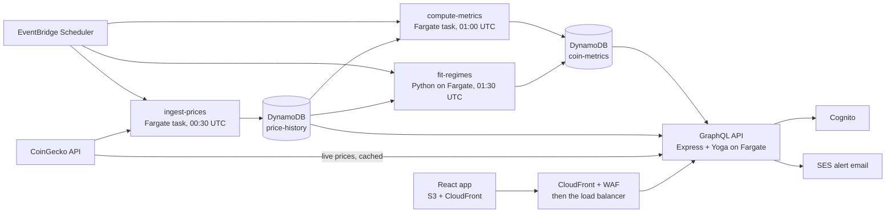

# CryptoQuantLab

Risk analytics for the 100 largest cryptocurrencies: realized and forecast volatility, GARCH with diagnostics, one-day Value at Risk and expected shortfall with out-of-sample backtests, and regimes, plus a Monte Carlo engine, portfolio construction and a signal backtester that aren't on the site yet. The models are implemented in TypeScript and checked against an independent Python reference built on numpy, scipy, statsmodels, `arch`, scikit-learn and PyPortfolioOpt. The hidden Markov model is fitted in Python by a nightly job and checked against hmmlearn and statsmodels.

**Live:** https://cryptoquantlab.com — open any coin and choose the **Risk** tab. The [Markets page](https://cryptoquantlab.com/markets) sorts the top 100 by volatility, drawdown and VaR, and shows each coin's regime. The [Methodology page](https://cryptoquantlab.com/methodology) has every model's formulas, assumptions, validation and references, next to today's numbers for Bitcoin.

## What it computes

All models run on stored daily closes (00:00 UTC) for the last 365 days. Nightly jobs compute them for each coin and the API serves the stored result.

| Model | Method | Code |
|---|---|---|
| Returns and moments | Log and simple returns; sample standard deviation; bias-adjusted skewness (G1) and excess kurtosis (G2) | [`returns.ts`](backend/src/models/returns.ts) |
| Realized volatility | 7, 30 and 90-day close-to-close; RiskMetrics EWMA (λ = 0.94), weight-normalised so it needs no seed | [`realizedVolatility.ts`](backend/src/models/realizedVolatility.ts) |
| HAR-RV | Corsi (2009) with 1, 7 and 30-day components for a market that trades every day; squared daily returns as the realized variance proxy; OLS by Householder QR | [`har.ts`](backend/src/models/har.ts), [`linearRegression.ts`](backend/src/models/linearRegression.ts) |
| GARCH(1,1) | Gaussian maximum likelihood on demeaned log returns; 1, 7 and 30-day forecasts | [`garch.ts`](backend/src/models/garch.ts) |
| GARCH diagnostics | Log-likelihood, AIC and BIC; Ljung-Box (10 lags) on standardized residuals and their squares; residual kurtosis; normal QQ; half-life in days | [`garchDiagnostics.ts`](backend/src/models/garchDiagnostics.ts) |
| Value at Risk and expected shortfall | One-day, 95% and 99%, by historical simulation, normal, Student-t (maximum likelihood) and GARCH-filtered historical simulation | [`valueAtRisk.ts`](backend/src/models/valueAtRisk.ts) |
| VaR backtests | Each day's VaR from the 180 returns before it; Kupiec unconditional coverage, Christoffersen independence, conditional coverage | [`varBacktest.ts`](backend/src/models/varBacktest.ts) |
| Return and drawdown | Geometric annualized return; Sharpe, Sortino and Calmar (risk-free rate 0); maximum, current and longest drawdown; worst days and week; beta and correlation to Bitcoin over a year and 90 days | [`performance.ts`](backend/src/models/performance.ts) |
| Regime | Threshold states, shown as a badge. Trend: the latest close against its 200-day simple moving average. Volatility level: the latest 30-day volatility's percentile among the year's 30-day windows, low below the 33rd and high above the 67th | [`regime.ts`](backend/src/models/regime.ts) |
| Hidden Markov model | Two Gaussian states on daily log returns, fitted by EM from ten starts in Python. Filtered and smoothed state probabilities, expected durations, and BIC against a single normal | [`hmm.py`](batch/cql_batch/hmm.py) |
| Probability functions | Log-gamma (Lanczos), incomplete gamma and beta (Lentz continued fractions), normal and Student-t pdf, cdf and quantile, chi-square tail | [`distributions.ts`](backend/src/models/distributions.ts) |
| Covariance | Sample covariance; Ledoit-Wolf shrinkage towards a scaled identity and towards constant correlation | [`covariance.ts`](backend/src/models/covariance.ts) |
| Portfolios | Long-only minimum variance and efficient frontier by a primal active-set method; risk parity by Newton's method on Spinu's convex form; risk contributions. Not on the site yet | [`portfolio.ts`](backend/src/models/portfolio.ts) |
| Signal backtests | Moving-average crossover positions; returns net of a proportional trading cost; walk-forward selection among variants; probabilistic and deflated Sharpe ratios (Bailey and López de Prado), with correlated variants counted as fewer independent trials. Not on the site yet | [`signals.ts`](backend/src/models/signals.ts), [`backtest.ts`](backend/src/models/backtest.ts), [`sharpeInference.ts`](backend/src/models/sharpeInference.ts) |
| Monte Carlo paths | Normal, Student-t and GARCH bootstrap (filtered historical simulation) paths of daily log returns, with optional antithetic pairs. Fan quantiles, horizon VaR and ES, and drawdown probabilities. numpy's SFC64 generator, Box-Muller normals, Marsaglia-Tsang gammas. Not on the site yet | [`monteCarlo.ts`](backend/src/models/monteCarlo.ts), [`random.ts`](backend/src/models/random.ts) |

## How the models are validated

[`validation/`](validation/) is a small Python package with a reference implementation of each model, written from the formulas. A script per model runs the reference on a fixed year of Bitcoin closes, compares it with a standard library, and writes a JSON fixture. It stops instead of writing the fixture if the two disagree. The TypeScript tests then compare against the fixture.

| Model | Reference checked against | Matches the reference to |
|---|---|---|
| Returns, moments | scipy, pandas (1e-12) | 1e-14 (returns), 1e-10 (moments) |
| Rolling and EWMA volatility | pandas `rolling().std()`, `ewm()` (1e-12) | 1e-12 |
| HAR-RV | statsmodels OLS (1e-10) | 1e-9, coefficients and all 30 forecast days |
| GARCH(1,1) | Multi-start SLSQP polished by Nelder-Mead; `arch` as a cross-check | log-likelihood 1e-4, parameters 1e-3 |
| Ljung-Box, AIC, BIC | statsmodels `acorr_ljungbox` | 1e-12 on the same residuals |
| Probability functions | scipy, 353 values into the far tails | worst case 1.3e-13 |
| Historical and normal VaR/ES | numpy quantile, scipy | 1e-12 |
| Student-t VaR/ES | scipy `t.fit` polished to the maximum | likelihood 1e-8, VaR 1e-6 |
| GARCH-filtered VaR/ES | the GARCH reference above | about 1e-6, every backtest exception day identical |
| Kupiec, Christoffersen | scipy chi-square | 1e-10 |
| Return, drawdown, beta | pandas `cummax`, `nsmallest`, `pct_change`; numpy `cov`, `corrcoef`; scipy `linregress` (1e-12) | 1e-12, every date identical |
| Regime | pandas `rolling().mean()`, `rolling().std()`, `rank(pct=True)` (1e-12) | 1e-12, trend and level identical, 12 cases across Bitcoin and Ethereum |
| Hidden Markov model, in Python | Enumerating every state path; hmmlearn; statsmodels `MarkovRegression` | Recursions 1e-12, EM iterates 1e-9, likelihood 1e-9; 20 statsmodels restarts find nothing higher |
| Covariance shrinkage | scikit-learn `LedoitWolf` (identity target); PyPortfolioOpt (constant correlation, on the same divide-by-n covariance) | 1e-12 |
| Portfolios | scipy SLSQP, then the optimality conditions solved exactly on the assets it holds; closed forms for two assets and uncorrelated assets | weights 1e-10 (minimum variance), 1e-9 (frontier); optimality conditions and equal risk shares 1e-12 |
| Signal backtests | pandas `rolling().mean()` and the same costed returns computed a second way (1e-12); the numerical example in Bailey and López de Prado (2014) | positions and walk-forward choices identical; returns 1e-15; Sharpe statistics 1e-12 |
| Monte Carlo | numpy's SFC64; scipy Kolmogorov-Smirnov tests; closed forms for the normal fan and the GARCH variance path | generator bit for bit; whole paths 1e-12 for every model, with and without antithetic pairs |

The validation turned up real bugs:

- The GARCH forecast started one step too early, so the one-day forecast was off by 4.2%. Comparing with `arch` found it.
- For stablecoins, the Student-t degrees of freedom tended to 2, and the next day's warm start took `log(0)`. That stalled the optimizer for 1.7 s per coin. Running every model over all stored coins, not only the Bitcoin fixture, found it.

### Bitcoin, one year to 2026-10-21

- **Distribution:** daily volatility 2.30%, about 44% annualized. Skewness −0.25, excess kurtosis 6.8.
- **GARCH:** α = 0.19, β = 0.64, half-life 3.6 days. Ljung-Box finds no remaining autocorrelation (p = 0.62) or clustering (p = 0.37) in the standardized residuals, but their excess kurtosis is still 2.6.
- **HAR-RV:** R² 0.13. Only the daily component is significant (HAC t = 4.5).
- **Return and drawdown:** −23.0% over the year; Sharpe −0.38, Sortino −0.54. Maximum drawdown −48.8% from 2025-10-27 to 2026-07-01, not recovered. Worst day −14.1% on 2026-02-06. Ethereum's beta to Bitcoin is 1.26, correlation 0.91.
- **Regime:** uptrend, with the price 1.14× its 200-day average. Volatility level low, with 30-day volatility at the 25th percentile.
- **Hidden Markov model:** a calm state at 31% annualized volatility lasting about 15 days, and a turbulent state at 83% lasting about 3 days. BIC −1740 against −1698 for one normal.

| 95% one-day VaR, 183 test days | VaR | ES | Exceptions (9.2 expected) | Kupiec p |
|---|---|---|---|---|
| Historical | 2.64% | 3.63% | 5 | 0.125 |
| Normal | 3.10% | 3.90% | 3 | 0.016 (too cautious) |
| Student-t, ν = 3.3 | 2.94% | 4.65% | 4 | 0.050 |
| GARCH-filtered | 2.42% | 3.16% | 7 | 0.448 |

Across the 93 coins with enough history, the 95% backtest passes for 86 with GARCH-filtered simulation, 80 historical, 69 Student-t and 58 normal.

### Why the hidden Markov model didn't replace the badge

The original plan was for this model to replace the threshold badge, and a walk-forward test didn't support that. Each coin's model was refitted weekly on the previous 180 returns and scored on the following days, using only data available at the time. These are the 82 coins with daily volatility of at least 0.5%:

| Next day | Hidden Markov | Threshold percentile |
|---|---|---|
| Move after the high state vs the low state, median ratio | 1.47× | 1.43× |
| Correlation with the size of the move, median | 0.11 | 0.16 |

Its one-day distribution is better, beating a normal with constant variance for 77 of those coins and with EWMA variance for 69, although a mixture's fatter tails explain at least part of that. It doesn't predict the size of the next move better than the simpler percentile, so the badge stayed and the model has its own panel.

Simulating a year from the fitted Bitcoin model shows what a year can identify. State volatilities are good to 6–14%, the turbulent state's stay probability has a 90% range of about 0.4 to 0.85, and the state means can't be told apart, so the states say nothing about direction.

### Does 10-day Monte Carlo VaR hold?

Each model was fitted to a coin's previous 180 returns and simulated 10 days ahead with 5,000 paths, on non-overlapping periods. These are the 83 coins with daily volatility of at least 0.5%, 1,467 forecasts per model:

| 10-day VaR | Exceptions at 95% | Kupiec p | Exceptions at 99% | Kupiec p |
|---|---|---|---|---|
| Normal | 2.9% | < 0.001 | 0.41% | 0.010 |
| Student-t | 2.0% | < 0.001 | 0.14% | < 0.001 |
| GARCH bootstrap | 3.7% | 0.022 | 0.61% | 0.11 |

Every model overstated the risk over these six months, the GARCH bootstrap least. When VaR was broken, the loss averaged about the predicted ES. About half the exceptions came in two market-wide falls, so the test has roughly 18 independent periods, and the p-values overstate the evidence.

Antithetic pairs cut the variance of the mean return 27–60 times but leave VaR and ES unchanged, because a bad path's mirror is a good one. Tail estimates need more paths instead: with 10,000, a 30-day 95% VaR is good to about a quarter of a percentage point.

### Long-only portfolios of the 20 largest coins

Each portfolio was set from the previous 90 or 180 days and held for 30, over about six months, averaged across six rebalancing schedules:

| Portfolio | Annualized volatility | Effective holdings | Realized ÷ forecast volatility |
|---|---|---|---|
| Minimum variance (any of three covariance estimates) | 21.7–21.9% | 1.9–3.6 | 0.98–1.31 |
| Risk parity | 34.5% | 13.5 | 0.96 |
| Cap-weighted | 38.1% | 2.0 | 0.90 |
| Equal weight | 44.6% | 20 | 0.99 |
| Highest Sharpe on the frontier | 51.3% | 3.2 | 0.96 |

Minimum variance cut volatility a lot, but by holding very few coins, mostly TRON. Without TRON it still had the lowest volatility, 26–28%. Its most concentrated versions understated their own risk by 25–31%, so the portfolio page will need a weight cap. Optimizing on a year of mean returns gave the riskiest portfolio and traded half of it each month.

In simulation, shrinking towards the identity, scikit-learn's default, made minimum variance worse than no shrinkage, because it pulls correlations towards zero. Shrinking towards a constant correlation roughly halved the excess risk. On real coins the three estimates were within two percentage points, in the same order.

### Do moving-average crossovers time the market?

The 15 crossovers of a 1, 5, 10 or 20-day average over a 20, 30, 50 or 100-day one were backtested on the 70 coins with a full year of history and daily volatility of at least 0.5%, at 15 basis points a trade:

| Best of 15 crossovers, 278 days | Coins passing | Passing on shuffled, demeaned prices |
|---|---|---|
| Probabilistic Sharpe ratio > 0.95 | 8.6% | 11.5% |
| Deflated Sharpe ratio > 0.95, 15 trials | 5.7% | 1.1% |
| Deflated Sharpe ratio > 0.95, about 4 implied independent trials | 7.1% | 2.6% |
| Timing p-value < 0.05 against the coin's own returns shuffled | 1.4% (1 coin) | |

The undeflated test passed the best crossover on pure noise more than twice as often as it should, and deflating for all 15 overcorrected because the crossovers are highly correlated. The coins that passed the deflated test were mostly coins that rose anyway: the test asks whether the Sharpe ratio is above zero, not whether the timing helped. A permutation test of timing found one coin below 0.05, where chance alone would give three or four.

Out of sample, retraining on 120 days and holding the winner for 30, the median Sharpe ratio fell from 0.73 for the best in-sample crossover to 0.32, against 0.35 for holding the coin over the same 158 days. The crossover beat holding on 53% of coins while spending about half its time out of the market.

### Notebooks

Six notebooks in [`validation/notebooks/`](validation/notebooks/) write up the main models in full, with their outputs:

- [`garch.ipynb`](validation/notebooks/garch.ipynb): the data's fat tails; the model and likelihood; estimation compared with `arch`; the likelihood surface; a simulation study of how well a year of data identifies the parameters; diagnostics; forecasts; limitations.
- [`value_at_risk.ipynb`](validation/notebooks/value_at_risk.ipynb): the four VaR and ES methods; the Student-t fit; rolling out-of-sample VaR with every exception marked; Kupiec and Christoffersen tests; the power of a one-year backtest; limitations.
- [`hmm.ipynb`](validation/notebooks/hmm.ipynb): the model and recursions; the fit compared with statsmodels; filtered and smoothed probabilities; how many states; what a year identifies; a walk-forward test against GARCH, EWMA and a threshold; limitations.
- [`monte_carlo.ipynb`](validation/notebooks/monte_carlo.ipynb): the three path models; random numbers tested against scipy; checks against closed forms; Monte Carlo error and what antithetic pairs do; Bitcoin's next 30 days; an out-of-sample test of 10-day VaR across coins; limitations.
- [`portfolio.ipynb`](validation/notebooks/portfolio.ipynb): two Ledoit-Wolf targets checked against scikit-learn and PyPortfolioOpt; a simulation of when shrinkage helps; minimum variance, risk parity and the frontier; an out-of-sample comparison on the top 20 coins, with and without TRON; limitations.
- [`backtest.ipynb`](validation/notebooks/backtest.ipynb): costed returns checked against pandas; the probabilistic and deflated Sharpe ratios against the paper's example; how often each passes on pure noise; crossovers on 70 coins in sample, against shuffled prices and walk-forward; limitations.

`uv run scripts/build_notebooks.py` regenerates and re-executes all six.

### Running the validation

```bash
cd validation
uv sync
uv run scripts/make_var_fixtures.py      # one script per model; each prints its results
```

The fixtures land in `backend/src/test/fixtures/`. The sample data is CoinGecko's daily Bitcoin and Ethereum series, in `validation/data/`, with the per-coin results of the hidden Markov and Monte Carlo cross-sections in `hmm_cross_section.csv` and `monte_carlo_cross_section.csv`, the Monte Carlo exceptions by period in `monte_carlo_periods.csv`, the portfolio comparison's results in `portfolio_backtest_summary.csv` and `portfolio_backtest_periods.csv`, and the crossover backtests' per-coin results and shuffled-price searches in `crossover_backtest_coins.csv` and `crossover_backtest_null.csv`. The hidden Markov model's tests run with `uv run pytest` in `batch/`.

## Architecture



- **Nightly pipeline.**
  - `ingest-prices` stores the midnight close, market cap and volume for the top 100 coins. A coin new to the top 100 gets a year of history in one run.
  - `compute-metrics` runs every model above for each coin and stores the result, plus one snapshot row of every coin's headline numbers for the Markets table.
  - `fit-regimes` fits the hidden Markov model for each coin. It runs from its own Python image, takes its coin list from that snapshot, and gets no secrets.
  - Each job has a missed-run and a failed-run alarm.
- **API.**
  - `riskSummary(coinId)` reads the stored result, and computes on request only for a coin the job hasn't covered yet. Each stored row carries a version, so a deploy that changes the summary never serves rows in the old shape.
  - `marketRisk` serves the nightly snapshot and `regimeModel(coinId)` serves the stored fit. Neither computes on request.
  - Signed-in users set moving-average crossover alerts. A 5-minute check records each trigger with a conditional write, so overlapping tasks during a deploy can't send duplicates, then emails the user's verified Cognito address.
- **Edge.** The API sits behind CloudFront and AWS WAF, and the load balancer accepts only CloudFront traffic.
- **Infrastructure as code.**
  - Everything is in OpenTofu under [`infrastructure/terraform`](infrastructure/terraform).
  - GitHub Actions deploys on every merge to `master` through OIDC, with no long-lived AWS keys, one deploy at a time.
  - Infrastructure changes are planned and reviewed before they're applied.
- **Monitoring.** CloudWatch alarms cover site and API health, 5xx errors, CPU and memory, the alert checker and all three jobs. Each alarm's email says what it means, how urgent it is, and the first commands to run.

## Repository layout

```
backend/
  src/models/        Pure model functions, one test file each
  src/services/      Risk summary, CoinGecko client, notifications
  src/jobs/          Nightly jobs and the 5-minute crossover checker
  src/repositories/  DynamoDB access
  src/resolvers/     GraphQL resolvers; schema in src/schema/graphql.ts
  src/test/fixtures/ Fixtures written by validation/
frontend/
  src/pages/         Dashboard, Markets, Methodology, coin page (Overview and Risk tabs)
  src/components/    MetricCard, ValueAtRiskPanel, GarchPanel, charts
batch/
  cql_batch/         Hidden Markov model and the nightly fit-regimes job
  tests/             Checks against path enumeration, hmmlearn and statsmodels
validation/
  cql_validation/    Python reference implementations
  scripts/           One fixture script per model
  notebooks/         Write-ups with outputs
infrastructure/terraform/
  modules/           vpc, backend_service, api_cdn, frontend_cdn, data, scheduled_jobs,
                     monitoring, cognito, email, route53, github_oidc
  environments/production/
```

## Running locally

Requires Node 24 and npm.

```bash
cd backend
npm install
cp .env.example .env
ENABLE_CROSSOVER_CHECKER=false npm run dev    # http://localhost:4000/graphql

cd ../frontend
npm install
cp .env.example .env
npm run dev                                   # http://localhost:3000
```

Keep the crossover checker off locally if `.env` points at shared tables, or it can send real alerts.

Tests run with `npm run test:run` in `backend/` and in `frontend/`, and `uv run pytest` in `batch/`.

## Data

Prices come from the [CoinGecko API](https://www.coingecko.com/en/api). The demo key used here has two limits:
- **365 days of history.** Rows are stored as they arrive, so the history grows past a year from now on.
- **No daily open, high or low.** Range-based volatility estimators such as Parkinson and Garman-Klass wait for an exchange OHLC source.

Data provided by CoinGecko.

## Not yet built

- A Scenario tab built on the Monte Carlo engine, with fan charts, loss distributions and multi-day VaR on the site.
- A portfolio page built on the portfolio models, with a maximum weight per coin, which the optimizer doesn't support yet.
- A Signals tab built on the backtester, showing each signal's walk-forward results and deflated Sharpe ratio next to holding the coin.

## Disclaimer

For information and education only. CryptoQuantLab is not investment advice and does not recommend buying or selling any asset. Models are estimates from past prices and can be wrong.

## License

No Public License
