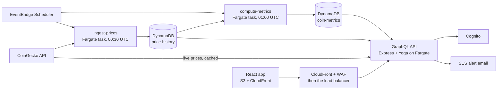

# CryptoQuantLab

Risk analytics for the 100 largest cryptocurrencies: realized and forecast volatility, GARCH with diagnostics, and one-day Value at Risk and expected shortfall with out-of-sample backtests. Every model is implemented in TypeScript and checked against an independent Python reference built on numpy, scipy, statsmodels and `arch`.

**Live:** https://cryptoquantlab.com — open any coin and choose the **Risk** tab. The [Methodology page](https://cryptoquantlab.com/methodology) has every model's formulas, assumptions, validation and references, next to today's numbers for Bitcoin.

## What it computes

All models run on stored daily closes (00:00 UTC) for the last 365 days. A nightly job computes them for each coin and the API serves the stored result.

| Model | Method | Code |
|---|---|---|
| Returns and moments | Log and simple returns; sample standard deviation; bias-adjusted skewness (G1) and excess kurtosis (G2) | [`returns.ts`](backend/src/models/returns.ts) |
| Realized volatility | 7, 30 and 90-day close-to-close; RiskMetrics EWMA (λ = 0.94), weight-normalised so it needs no seed | [`realizedVolatility.ts`](backend/src/models/realizedVolatility.ts) |
| HAR-RV | Corsi (2009) with 1, 7 and 30-day components for a market that trades every day; squared daily returns as the realized variance proxy; OLS by Householder QR | [`har.ts`](backend/src/models/har.ts), [`linearRegression.ts`](backend/src/models/linearRegression.ts) |
| GARCH(1,1) | Gaussian maximum likelihood on demeaned log returns; 1, 7 and 30-day forecasts | [`garch.ts`](backend/src/models/garch.ts) |
| GARCH diagnostics | Log-likelihood, AIC and BIC; Ljung-Box (10 lags) on standardized residuals and their squares; residual kurtosis; normal QQ; half-life in days | [`garchDiagnostics.ts`](backend/src/models/garchDiagnostics.ts) |
| Value at Risk and expected shortfall | One-day, 95% and 99%, by historical simulation, normal, Student-t (maximum likelihood) and GARCH-filtered historical simulation | [`valueAtRisk.ts`](backend/src/models/valueAtRisk.ts) |
| VaR backtests | Each day's VaR from the 180 returns before it; Kupiec unconditional coverage, Christoffersen independence, conditional coverage | [`varBacktest.ts`](backend/src/models/varBacktest.ts) |
| Return and drawdown | Geometric annualized return; Sharpe, Sortino and Calmar (risk-free rate 0); maximum, current and longest drawdown; worst days and week; beta and correlation to Bitcoin over a year and 90 days | [`performance.ts`](backend/src/models/performance.ts) |
| Probability functions | Log-gamma (Lanczos), incomplete gamma and beta (Lentz continued fractions), normal and Student-t pdf, cdf and quantile, chi-square tail | [`distributions.ts`](backend/src/models/distributions.ts) |

## How the models are validated

[`validation/`](validation/) is a small Python package with a reference implementation of each model, written from the formulas. A script per model runs the reference on a fixed year of Bitcoin closes, compares it with a standard library, and writes a JSON fixture. It stops instead of writing the fixture if the two disagree. The TypeScript tests then compare against the fixture.

| Model | Reference checked against | TypeScript matches the reference to |
|---|---|---|
| Returns, moments | scipy, pandas (1e-12) | 1e-14 (returns), 1e-10 (moments) |
| Rolling and EWMA volatility | pandas `rolling().std()`, `ewm()` (1e-12) | 1e-12 |
| HAR-RV | statsmodels OLS (1e-10) | 1e-9, coefficients and all 30 forecast days |
| GARCH(1,1) | Multi-start SLSQP polished by Nelder-Mead; `arch` as a cross-check | log-likelihood 1e-4, parameters 1e-3 |
| Ljung-Box, AIC, BIC | statsmodels `acorr_ljungbox` | 1e-12 on the same residuals |
| Probability functions | scipy, 353 values into the far tails | worst case 1.3e-13 |
| Historical and normal VaR/ES | numpy quantile, scipy | 1e-12 |
| Student-t VaR/ES | scipy `t.fit` polished to the maximum | likelihood 1e-8, VaR 1e-6 |
| GARCH-filtered VaR/ES | the GARCH reference above | about 1e-6, every backtest exception day identical |
| Kupiec, Christoffersen | scipy chi-square | 1e-10 |
| Return, drawdown, beta | pandas `cummax`, `nsmallest`, `pct_change`; numpy `cov`, `corrcoef`; scipy `linregress` (1e-12) | 1e-12, every date identical |

The validation turned up real bugs:

- The GARCH forecast started one step too early, so the one-day forecast was off by 4.2%. Comparing with `arch` found it.
- For stablecoins, the Student-t degrees of freedom tended to 2, and the next day's warm start took `log(0)`. That stalled the optimizer for 1.7 s per coin. Running every model over all stored coins, not only the Bitcoin fixture, found it.

### Bitcoin, one year to 2026-10-21

- **Distribution:** daily volatility 2.30%, about 44% annualized. Skewness −0.25, excess kurtosis 6.8.
- **GARCH:** α = 0.19, β = 0.64, half-life 3.6 days. Ljung-Box finds no remaining autocorrelation (p = 0.62) or clustering (p = 0.37) in the standardized residuals, but their excess kurtosis is still 2.6.
- **HAR-RV:** R² 0.13. Only the daily component is significant (HAC t = 4.5).
- **Return and drawdown:** −23.0% over the year; Sharpe −0.38, Sortino −0.54. Maximum drawdown −48.8% from 2025-10-27 to 2026-07-01, not recovered. Worst day −14.1% on 2026-02-06. Ethereum's beta to Bitcoin is 1.26, correlation 0.91.

| 95% one-day VaR, 183 test days | VaR | ES | Exceptions (9.2 expected) | Kupiec p |
|---|---|---|---|---|
| Historical | 2.64% | 3.63% | 5 | 0.125 |
| Normal | 3.10% | 3.90% | 3 | 0.016 (too cautious) |
| Student-t, ν = 3.3 | 2.94% | 4.65% | 4 | 0.050 |
| GARCH-filtered | 2.42% | 3.16% | 7 | 0.448 |

Across the 93 coins with enough history, the 95% backtest passes for 86 with GARCH-filtered simulation, 80 historical, 69 Student-t and 58 normal.

### Notebooks

Two notebooks in [`validation/notebooks/`](validation/notebooks/) write up the main models in full, with their outputs:

- [`garch.ipynb`](validation/notebooks/garch.ipynb): the data's fat tails; the model and likelihood; estimation compared with `arch`; the likelihood surface; a simulation study of how well a year of data identifies the parameters; diagnostics; forecasts; limitations.
- [`value_at_risk.ipynb`](validation/notebooks/value_at_risk.ipynb): the four VaR and ES methods; the Student-t fit; rolling out-of-sample VaR with every exception marked; Kupiec and Christoffersen tests; the power of a one-year backtest; limitations.

`uv run scripts/build_notebooks.py` regenerates and re-executes both.

### Running the validation

```bash
cd validation
uv sync
uv run scripts/make_var_fixtures.py      # one script per model; each prints its results
```

The fixtures land in `backend/src/test/fixtures/`. The sample data is CoinGecko's daily Bitcoin series, in `validation/data/`.

## Architecture



- **Nightly pipeline.**
  - `ingest-prices` stores the midnight close, market cap and volume for the top 100 coins. A coin new to the top 100 gets a year of history in one run.
  - `compute-metrics` runs every model above for each coin and stores the result.
  - Each job has a missed-run and a failed-run alarm.
- **API.**
  - `riskSummary(coinId)` reads the stored result, and computes on request only for a coin the job hasn't covered yet. Each stored row carries a version, so a deploy that changes the summary never serves rows in the old shape.
  - Signed-in users set moving-average crossover alerts. A 5-minute check records each trigger with a conditional write, so overlapping tasks during a deploy can't send duplicates, then emails the user's verified Cognito address.
- **Edge.** The API sits behind CloudFront and AWS WAF, and the load balancer accepts only CloudFront traffic.
- **Infrastructure as code.**
  - Everything is in OpenTofu under [`infrastructure/terraform`](infrastructure/terraform).
  - GitHub Actions deploys on every merge to `master` through OIDC, with no long-lived AWS keys, one deploy at a time.
  - Infrastructure changes are planned and reviewed before they're applied.
- **Monitoring.** CloudWatch alarms cover site and API health, 5xx errors, CPU and memory, the alert checker and both jobs. Each alarm's email says what it means, how urgent it is, and the first commands to run.

## Repository layout

```
backend/
  src/models/        Pure model functions, one test file each
  src/services/      Risk summary, CoinGecko client, notifications
  src/jobs/          Nightly jobs and the 5-minute crossover checker
  src/repositories/  DynamoDB access
  src/resolvers/     GraphQL resolvers; schema in src/schema/graphql.ts
  src/test/fixtures/ Fixtures written by validation/
frontend/
  src/pages/         Dashboard, Markets, coin page (Overview and Risk tabs)
  src/components/    MetricCard, ValueAtRiskPanel, GarchPanel, charts
validation/
  cql_validation/    Python reference implementations
  scripts/           One fixture script per model
infrastructure/terraform/
  modules/           vpc, backend_service, api_cdn, frontend_cdn, data, scheduled_jobs,
                     monitoring, cognito, email, route53, github_oidc
  environments/production/
```

## Running locally

Requires Node 24 and npm.

```bash
cd backend
npm install
cp .env.example .env
ENABLE_CROSSOVER_CHECKER=false npm run dev    # http://localhost:4000/graphql

cd ../frontend
npm install
cp .env.example .env
npm run dev                                   # http://localhost:3000
```

Keep the crossover checker off locally if `.env` points at shared tables, or it can send real alerts.

Tests run with `npm run test:run` in `backend/` and in `frontend/`.

## Data

Prices come from the [CoinGecko API](https://www.coingecko.com/en/api). The demo key used here has two limits:
- **365 days of history.** Rows are stored as they arrive, so the history grows past a year from now on.
- **No daily open, high or low.** Range-based volatility estimators such as Parkinson and Garman-Klass wait for an exchange OHLC source.

Data provided by CoinGecko.

## Not yet built

- 10-day VaR, which needs Monte Carlo simulation.
- Regime detection.
- Risk columns on the Markets page.

## Disclaimer

For information and education only. CryptoQuantLab is not investment advice and does not recommend buying or selling any asset. Models are estimates from past prices and can be wrong.

## License

No Public License
